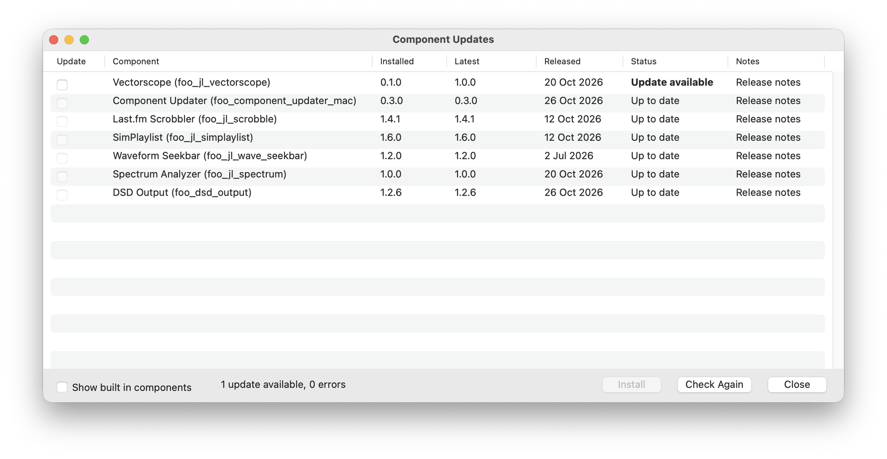
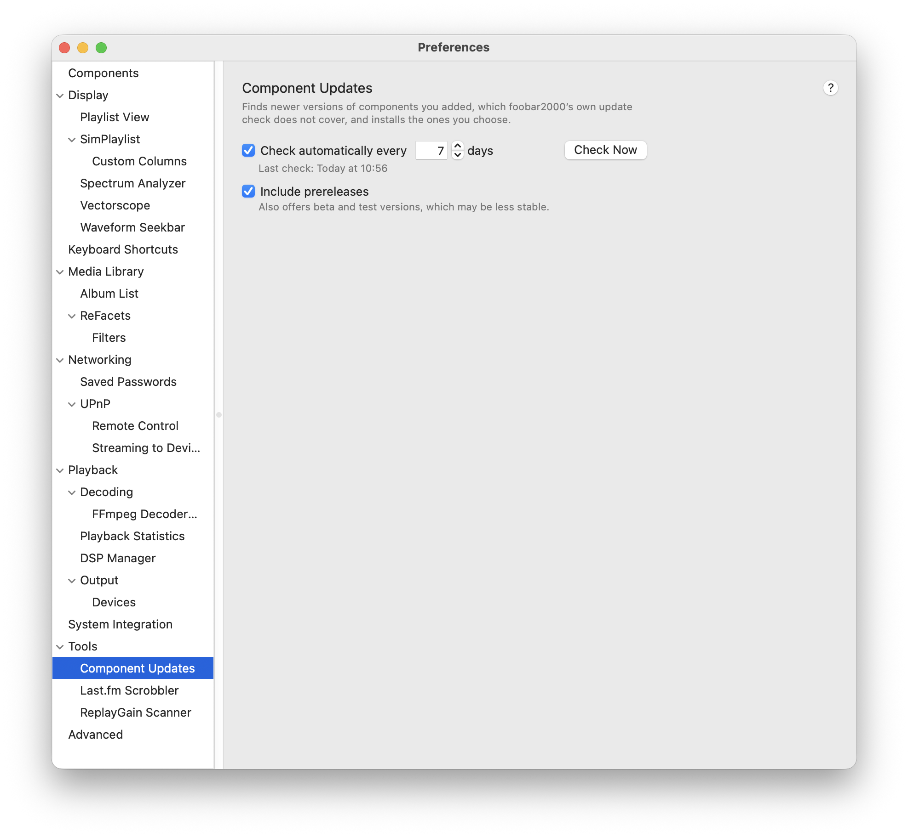

# foo_component_updater_mac

foobar2000 for Mac checks only itself for updates; this component checks the components you added.

<p align="center">
  
  <br>
  <em>Help > Check for Component Updates...: every installed component with its installed and latest version and the release date.</em>
</p>

<p align="center">
  
  <br>
  <em>Preferences > Tools > Component Updates: schedule and prereleases.</em>
</p>

## Install

1. Download `foo_component_updater_mac.fb2k-component` from the [Releases](https://github.com/alies-dev/foo_component_updater_mac/releases) page.
2. In foobar2000 open Settings... > Components, click `+` and choose the file.
3. Restart foobar2000.

Requires macOS 12 or newer, Apple Silicon or Intel.

## Features

* A results window with the installed and the latest version of each component, its status and a link to the release notes.
* Installs the updates you tick: select the rows, click Install, then restart foobar2000. The version it replaces is kept, and right click > Restore Previous brings it back. The updater's own row works the same way.
* Shows "Replaced" when a component names its successor, and switches to it when you tick the row: the successor is installed and the old component removed at the next start. Migration notes the author links to are offered with one click, before the switch and once after it. Right click > Keep stays with the old one.
* Warns when two installed components do the same job (Last.fm scrobblers so far): each would do the work twice.
* Finds updates on GitHub (including repositories with several components), in the foobar2000.org catalog and in the shared component registry. Authors can declare their source with an `FB2KUpdateSource` key.
* Checks automatically every few days.
* foobar2000's built in components are hidden unless you ask for them.

## Privacy and safety

* Nothing is downloaded or installed until you tick an update and click Install. Only `.fb2k-component` packages are installed (GitHub `.zip` files are only reported), and only from the source the update was found at.
* Before anything is replaced the package must have a valid code signature, the same bundle identifier as the installed component and, when the installed one has a Team ID, the same Team ID. The new version waits in foobar2000's `pending` folder and is applied at the next start.
* A switch to a successor installs a different component, so there is no bundle identifier to compare: its package must have a valid signature and a bundle identifier, and when the old component is signed with a Developer ID, the same Team ID (or the one its declaration names). The switch is confirmed first. The successor is named only by the old component's own `Info.plist` or by this updater's built in list, and its code comes only from the source declared there.
* HTTPS only. It contacts GitHub (releases and the shared registry), foobar2000.org and the release hosts named by the shared registry, a component's `FB2KUpdateSource` or the source of its declared successor (`FB2KReplacedBy`), and nothing else.
* No personal data, no telemetry.

## If an update breaks the updater itself

Restore Previous is in this component's own window, so it cannot help when the new version does not load. The version it replaced is kept in `~/Library/foobar2000-v2/foo_component_updater_mac/backup/foo_component_updater_mac/`. Either install the older `.fb2k-component` from the Releases page through Settings... > Components > `+`, or put the kept copy back and start foobar2000:

```
cd ~/Library/foobar2000-v2
mkdir -p user-components/pending/foo_component_updater_mac
cp -R foo_component_updater_mac/backup/foo_component_updater_mac/foo_component_updater_mac.component user-components/pending/foo_component_updater_mac/
```

## For component authors

See [docs/component-authors.md](docs/component-authors.md) to make your component updatable.

## Development

```
export FB2K_SDK_PATH=/path/to/SDK-2026-10-01   # built SDK libraries, not part of this repository
./Scripts/build.sh --install                   # unit tests, build, copy into user-components
```

GitHub Actions builds and tests every pull request and every push to `main`. A release is made by pushing a tag `vX.Y.Z` that matches `FCU_VERSION` in `src/version.h`; the matching `CHANGELOG.md` section becomes the release notes, so keep it to a few user visible bullets. More notes are in [docs/sdk-quirks.md](docs/sdk-quirks.md).

## Supported components

The updater knows the GitHub repository of these components, so it finds their updates without the foobar2000.org catalog or the shared registry:

| Component | How |
| --- | --- |
| [foo_ui_panels](https://github.com/santiagorod92/foo_ui_panels) | Declared by the component |
| [foo_navidrome](https://github.com/santiagorod92/foo_navidrome) | Declared by the component |
| [foo_dsd_output](https://github.com/dingql/foobar2000_dsd_mac) | Declared by the component |
| [foo_jl_album_art](https://github.com/JendaT/fb2k-components-mac-suite) | Built into the updater |
| [foo_jl_biography](https://github.com/JendaT/fb2k-components-mac-suite) | Built into the updater |
| [foo_jl_effects_dsp](https://github.com/JendaT/fb2k-components-mac-suite) | Built into the updater |
| [foo_jl_plorg](https://github.com/JendaT/fb2k-components-mac-suite) | Built into the updater |
| [foo_jl_queue_manager](https://github.com/JendaT/fb2k-components-mac-suite) | Built into the updater |
| [foo_jl_scrobble](https://github.com/JendaT/fb2k-components-mac-suite) | Built into the updater |
| [foo_jl_simplaylist](https://github.com/JendaT/fb2k-components-mac-suite) | Built into the updater |
| [foo_jl_spectrum](https://github.com/JendaT/fb2k-components-mac-suite) | Built into the updater |
| [foo_jl_tidal](https://github.com/JendaT/fb2k-components-mac-suite) | Built into the updater |
| [foo_jl_vectorscope](https://github.com/JendaT/fb2k-components-mac-suite) | Built into the updater |
| [foo_jl_wave_seekbar](https://github.com/JendaT/fb2k-components-mac-suite) | Built into the updater |
| [foo_mac_scrobble](https://github.com/avelytchko/foo_mac_scrobble) | Built into the updater |
| [foo_vis_projectm_mac](https://github.com/Stwarf/foo_vis_projectm_mac) | Built into the updater |
| [foo_cyan_leaf](https://github.com/CyanLeafcomponent/cyan-leaf-downloads) | Built into the updater |
| [foo_vis_projectMacOS](https://github.com/gabitoesmiapodo/projectMacOS) | Built into the updater |
| [foo_richtext_mac](https://github.com/seongbin/foo_richtext_mac) | Built into the updater |
| [foo_dms_browser](https://github.com/sunick2009/foo_upnp_mac) | Built into the updater |
| [foo_lastfm](https://github.com/Scannou/foo-lastfm) | Built into the updater |

*Declared by the component*: the component's `Info.plist` names its source (`FB2KUpdateSource`, see [docs/component-authors.md](docs/component-authors.md)). *Built into the updater*: the source is listed in [Resources/extra_components.json](Resources/extra_components.json), which ships with the updater.

Other components are found through the foobar2000.org catalog or the shared registry when they are listed there.

## Credits

The update checking logic comes from [foo_component_update_checker](https://github.com/p2ashiura/foo_component_update_checker) by p2ashiura (MIT) and its shared registry [foo_component_update_checker-registry](https://github.com/p2ashiura/foo_component_update_checker-registry). The build layout follows [JendaT/fb2k-components-mac-suite](https://github.com/JendaT/fb2k-components-mac-suite). JSON parsing by [nlohmann/json](https://github.com/nlohmann/json).

## License

MIT, see [LICENSE](LICENSE). Copyright 2026 alies-dev, ported files copyright 2026 p2ashiura.
